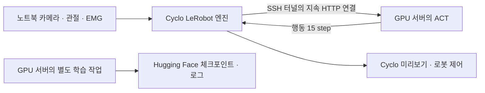

# KROC EMG Server

KROC 물건 건네기 실험의 GPU 서버 학습, 체크포인트 보관, Cyclo 원격 실행 구성입니다. 기존 KROC의 ACT 구현을 기준으로 10/10/10 균형 학습, EMG spectrogram, 회전 방향 보조 분류, 320ms 비교를 재현합니다.

| 문서 | 내용 |
| --- | --- |
| [학습 재현과 서버 운영](docs/TRAINING.md) | 환경 설치, 데이터·캐시, Supervisor 실행 순서, Hugging Face 업로드와 연장 조건 |
| [GPU 추론과 노트북 Cyclo 연결](docs/INFERENCE.md) | 배포 모델과 SHA-256, SSH 터널, 카메라·EMG 입력, 합성 테스트 |
| [진행한 실험과 결과](docs/EXPERIMENTS.md) | 학습 조건과 상태, 검증값, 모델·로그 링크 |
| [데이터 계약](docs/DATA_CONTRACT.md) | 카메라, 로봇, EMG의 시간 정렬과 데이터 형식 |
| [실행 스냅샷](reports/experiment_snapshot.json) | 실험별 마지막 step과 검증된 업로드 목록 |

- 기반 학습 코드 [YWhero/KROC `15a1971`](https://github.com/YWhero/KROC/tree/15a1971bcb7b79b8dbe46ea545d2530a0f1f93ab)
- 균형 학습 아카이브 [HYHero/kroc-act-emg-balanced-20261123](https://huggingface.co/HYHero/kroc-act-emg-balanced-20261123)
- 현재 추론 서비스 모델 [HYHero/kroc-act-emg-checkpoints](https://huggingface.co/HYHero/kroc-act-emg-checkpoints/tree/98cbacdd225911d24b2728df29c71c1282e12901/runs)
